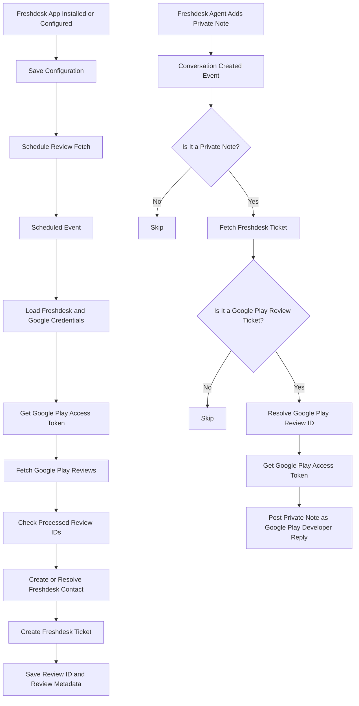

# ⭐ Google Play Store Reviews ↔ Freshdesk Integration

### Bring Google Play Store reviews into Freshdesk — and reply to reviewers directly from Freshdesk

A Freshdesk serverless custom app that periodically fetches Google Play Store reviews, creates Freshdesk contacts and tickets, and publishes an agent's private Freshdesk reply back to the corresponding Google Play review.


---

## 📌 About the Project

**Google Play Store Reviews ↔ Freshdesk Integration** is a Freshdesk serverless custom app designed to help support teams manage Android app reviews without switching between Google Play Console and Freshdesk.

The app periodically retrieves reviews from the Google Play Developer API and creates corresponding contacts and support tickets in Freshdesk. It captures review details such as the rating, reviewer, review text, review date, app version, device name, and review ID.

When a Freshdesk agent adds a **private note** to a ticket created from a Google Play review, the app identifies the related review and posts that note as the developer's reply on Google Play.

This creates a practical workflow in which the support team can review and respond to Google Play feedback from within Freshdesk.

## ✨ Key Features

### 1. Google Play Store → Freshdesk

- Periodically fetches Google Play Store reviews using the Google Play Developer API.
- Uses a Google Cloud service account and OAuth 2.0 JWT authentication.
- Creates or resolves a Freshdesk contact for a reviewer.
- Creates a Freshdesk ticket for each eligible review comment.
- Includes the app name, review rating, reviewer name, review date, app version, review title/text, developer reply (when present in the review response), and review ID in the ticket description.
- Assigns ticket priority based on the star rating:
  - 1–2 stars: higher priority.
  - 3–5 stars: normal priority.
- Adds identifying tags such as `app-review`, `google-play`, app name, and rating.
- Stores review metadata in configurable Freshdesk custom fields.
- Uses a persistent record of processed review IDs to reduce duplicate ticket creation.

### 2. Freshdesk → Google Play Store

- Listens for Freshdesk conversation-created events.
- Checks whether the conversation is a **private note**.
- Retrieves the related Freshdesk ticket.
- Identifies Google Play review tickets using the ticket subject or configured review-type custom field.
- Resolves the Google Play review ID from the configured custom field or ticket description.
- Authenticates with the Google Play Developer API.
- Posts the private Freshdesk note as a developer reply to the corresponding Google Play review.

**Important:** The current implementation intentionally skips public conversations. The reply workflow is triggered by a private Freshdesk note on a recognized Google Play review ticket.

### 3. Custom Installation and Configuration Page

The app includes a Freshdesk installation configuration page built with HTML, JavaScript, and Freshworks Crayons.

It allows an administrator to configure:

- Freshdesk domain.
- Freshdesk API key.
- Android application package name.
- Application display name.
- App division or brand label.
- Google Cloud service-account JSON key.
- Freshdesk custom-field names for review rating, review ID, device name, and review type.

The setup page can test the Freshdesk connection and automatically retrieve available ticket fields. Administrators can select detected custom fields or enter field names manually.

### 4. Scheduling and Duplicate Prevention

- Schedules the initial review synchronization after installation or configuration.
- Runs the review-fetch workflow approximately every six minutes through Freshworks scheduled events.
- Stores configuration in Freshworks app storage (`$db`) so scheduled events can retrieve it.
- Tracks recently processed review IDs in `$db`.
- Uses the review ID as the contact's `unique_external_id` when creating a Freshdesk contact.
- Limits the stored processed-review ID history to the most recent 100 IDs.

## 🔄 How the Integration Works



### Workflow summary

| Direction | Trigger | Result |
|---|---|---|
| Google Play → Freshdesk | Scheduled event | Fetch reviews and create Freshdesk contacts/tickets for eligible new reviews |
| Freshdesk → Google Play | Private note created on a recognized review ticket | Post the note as a developer reply to the matching Google Play review |
| Configuration | App installation, app update, or setup save | Store configuration and schedule the review-fetch job |

## 🧰 Technology Stack

| Area | Technology |
|---|---|
| App platform | Freshworks Developer Platform 3.0 |
| Runtime | Node.js 24.11.0 (declared in `manifest.json`) |
| Freshworks CLI | FDK 10.1.10 (declared in `manifest.json`) |
| Language | JavaScript |
| Freshdesk integration | Freshdesk REST API v2 |
| Google integration | Google Play Developer API |
| Google authentication | `google-auth-library` and service-account JWT |
| Installation UI | HTML, JavaScript, Freshworks App Client |
| UI styling | Freshworks Crayons v4 |
| Persistent app storage | Freshworks `$db` |
| Scheduling | Freshworks `$schedule` |
| HTTP request templates | Freshworks `$request.invokeTemplate` |
| Testing | Vitest 2.1.8 |
| Coverage | `@vitest/coverage-v8` |

## 🗂️ Project Structure

```text
google-play-freshdesk-integration/
│
├── config/
│   ├── iparams.html          # Freshdesk and Google Play setup page
│   └── requests.json         # Freshdesk and Google Play API request templates
│
├── server/
│   └── server.js             # Scheduled sync, review processing and reply logic
│
├── tests/
│   └── server.test.js        # Serverless handler and helper tests
│
├── manifest.json             # Freshworks app manifest and event registrations
├── package.json              # Dependencies and test command
├── package-lock.json
├── vitest.config.js           # Vitest and coverage configuration
└── README.md
```

## 🔌 Freshworks App Events and Functions

The app registers the following events and function in `manifest.json`.

| Event / Function | Purpose |
|---|---|
| `onAppInstall` | Saves the installation configuration and schedules the initial review synchronization. |
| `afterAppUpdate` | Saves updated configuration and schedules the initial synchronization. |
| `onScheduledEvent` | Fetches Google Play reviews, filters previously processed reviews, creates Freshdesk contacts/tickets, and schedules the next run. |
| `onConversationCreate` | Checks a newly created Freshdesk conversation and posts eligible private notes to Google Play. |
| `saveConfig` | Saves configuration through the server method and schedules the initial synchronization. |

The app also defines the following request templates in `config/requests.json`:

| Request template | API operation |
|---|---|
| `getReview` | Retrieves Google Play Store reviews for the configured Android package. |
| `postReview` | Posts a developer reply to a Google Play review. |
| `createContact` | Creates a Freshdesk contact for the reviewer. |
| `createTicket` | Creates a Freshdesk ticket from the review. |
| `getTicket` | Retrieves the Freshdesk ticket before posting a reply to Google Play. |
| `fillterTickets` | Searches Freshdesk tickets by the configured Google Play review-type field. |
| `getTicketFields` | Retrieves Freshdesk ticket fields for configuration and mapping. |

## ⚙️ Prerequisites

Before configuring the app, you need:

1. A Freshdesk account with permission to install custom apps and access the Freshdesk API.
2. A Freshdesk API key for the account that will be used by the app.
3. A Google Play Developer account with access to the Android application whose reviews will be synchronized.
4. A Google Cloud service account with the required Google Play Developer API access.
5. The Android application's package name, for example `com.example.androidapp`.
6. Freshdesk custom ticket fields for the review metadata, or permission to create them.

## 🔐 Google Play Service Account Setup

The app uses a Google Cloud service account to authenticate with the Google Play Developer API.

At a high level:

1. Open the Google Cloud project associated with your Android application.
2. Enable the Google Play Android Developer API.
3. Create a service account and generate a JSON key.
4. Grant that service account the required permissions for the app in Google Play Console.
5. Download the service-account JSON key.
6. Upload the JSON file in the Freshdesk app configuration page.

The JSON key must contain at least:

- `client_email`
- `private_key`

The configuration page checks that the JSON can be parsed and that these two properties exist. This is a basic format check; it does not prove that the service account has the necessary Google Play permissions. Verify access with a test synchronization.

Official references:

- [Google Play Developer API](https://developers.google.com/android-publisher)
- [Google Play Developer API authentication](https://developers.google.com/android-publisher/authorization)
- [Google Cloud service accounts](https://cloud.google.com/iam/docs/service-accounts)

**Security:** Treat the service-account JSON as a private key. Never commit it to GitHub, paste it into public issue reports, or include it in screenshots.

## 🛠️ Freshdesk Configuration

Open the app's installation/configuration page and enter the following information.

### Freshdesk instance connection

| Setting | Description |
|---|---|
| Freshdesk Domain | Your Freshdesk hostname, such as `yourcompany.freshdesk.com`; do not include `https://`. |
| Freshdesk API Key | API key from the Freshdesk agent profile. |

Use **Auto-Detect Ticket Fields from Freshdesk** to test the connection and load available custom ticket fields.

### Google Play app setup

| Setting | Description |
|---|---|
| Android App Package Name | Android package name from the Google Play Store listing. |
| App Name | Display name used in Freshdesk ticket subjects and tags. |
| App Division / Brand | Optional brand or division label included in the ticket description. |
| Google Service Account Key | Service-account JSON containing `client_email` and `private_key`. |

### Freshdesk custom-field mapping

The app supports configurable Freshdesk field names for these values:

| Field setting | Purpose | Default field name |
|---|---|---|
| Review Rating | Stores the review's star rating | `cf_review_rating` |
| Review ID | Stores the Google Play review identifier | `cf_reviewid` |
| Device Name | Stores the reviewer's device model, when available | `cf_device_name` |
| Review Type | Identifies the ticket as a Google Play review | `cf_review_type` |

Create these custom fields in Freshdesk before using the integration, or select existing fields through the setup page. The field names configured in the app must match the actual Freshdesk custom-field API names.

## 📨 What Gets Created in Freshdesk?

For each eligible Google Play review, the app:

1. Creates or resolves a Freshdesk contact using the reviewer name and review ID as the external identifier.
2. Creates a Freshdesk ticket containing the review information.
3. Adds review-specific tags.
4. Populates the configured custom fields.

### Ticket subject

The subject is generated using this pattern:

```text
[Google Play] <rating>/5 - <app name> - <review title or text>
```

### Ticket description

The ticket description can include:

- Store name.
- App name and division.
- Star rating.
- Reviewer name.
- Review date.
- App version.
- Review title.
- Review text.
- Developer reply currently included in the retrieved review data, if available.
- Google Play review ID.

### Ticket priority

The current implementation assigns:

| Google Play rating | Freshdesk priority |
|---|---|
| 1 or 2 stars | High |
| 3, 4 or 5 stars | Normal |

The app creates tickets with Freshdesk status ID `2`.

### Ticket tags

Tickets receive tags such as:

- `app-review`
- `google-play`
- App-name slug
- `rating-1` through `rating-5`

## 💬 Reply to Google Play Reviews from Freshdesk

One of the main features of this app is the ability to respond to Google Play reviews directly from Freshdesk.

### Reply workflow

1. A Google Play review is synchronized and appears as a Freshdesk ticket.
2. The agent opens the corresponding Freshdesk ticket.
3. The agent adds a **private note** containing the reply.
4. The app receives the Freshdesk conversation-created event.
5. It checks that the conversation is private and that the ticket belongs to Google Play.
6. It retrieves the review ID from the configured custom field or ticket description.
7. It authenticates with the Google Play Developer API.
8. It submits the note text as the developer reply for that review.

**Important operational notes:**

- Use a private note for the Google Play reply workflow. Public replies are ignored by the current implementation.
- The ticket must be recognizable as a Google Play ticket through its subject or configured review-type field.
- The ticket must contain a valid Google Play review ID.
- Google Play API permissions and the correct package name must be configured.
- The note is submitted as the developer reply text. Review the content before posting because the action publishes a response on Google Play.

## ⏱️ Scheduled Review Synchronization

The app creates a scheduled job named `fetch_playstore_reviews`.

- The initial scheduled execution is planned approximately six minutes after installation or configuration save.
- After a scheduled execution, the app schedules the next execution approximately six minutes later.
- Each run retrieves the available reviews returned by the Google Play API, checks the stored processed-review IDs, and processes eligible reviews.
- The app stores up to 100 recently processed review IDs in Freshworks `$db` to reduce duplicate ticket creation.

The schedule is app-managed through Freshworks scheduled events. It is not a real-time Google Play push notification integration.

## 💻 Local Development and Testing

### Prerequisites

- Node.js compatible with the runtime declared in `manifest.json` (`24.11.0`).
- Freshworks Developer Kit (FDK) compatible with the app manifest (`10.1.10`).
- npm.
- A Freshworks developer/testing environment.
- Test Freshdesk and Google Play app configuration.

### 1. Clone the repository

```bash
git clone <YOUR_GITHUB_REPOSITORY_URL>
cd <YOUR_PROJECT_DIRECTORY>
```

Replace the placeholders with your actual GitHub repository URL and project directory.

### 2. Install dependencies

```bash
npm install
```

### 3. Configure the app

Use the Freshworks app installation/configuration page to enter your Freshdesk domain, API key, Google Play package name, service-account JSON, app name, and custom-field names.

Do not place real credentials in source files or commit them to GitHub.

### 4. Run unit tests

```bash
npm run fdk-unit-test
```

The command runs Vitest with V8 coverage enabled.

### 5. Run the app locally

```bash
fdk run
```

Use the Freshworks local testing workflow to provide installation parameters and test app events.

### 6. Validate the app

```bash
fdk validate
```

### 7. Package the app

```bash
fdk pack
```

The Freshworks CLI packages the app for installation. Keep generated build output and packaged ZIP files out of source control unless you intentionally publish a release artifact.

Official Freshworks references:

- [Freshworks Developer Platform](https://developers.freshworks.com/)
- [Freshworks CLI setup](https://developers.freshworks.com/docs/guides/setup/cli-setup/)
- [Freshworks FDK documentation](https://developers.freshworks.com/docs/app-sdk/v3.0/task/basic-dev-tools/freshworks-cli/)

## 🧪 Testing

The repository includes a Vitest test file that checks:

- The `onAppInstallHandler` export.
- The `afterAppUpdateHandler` export.
- The `onScheduledEventHandler` export.
- The `onConversationCreateHandler` export.
- The `saveConfig` function.
- The `handleResponse` helper.
- Basic success-response logging behavior.

Run the test suite with:

```bash
npm run fdk-unit-test
```

**Testing scope:** These are basic unit/smoke tests for handler availability and the response helper. They do not constitute end-to-end tests of Freshdesk authentication, Google service-account authentication, review retrieval, ticket creation, or publishing replies to Google Play. Test those workflows in a non-production environment before deployment.

## 🔒 Security Considerations

This app handles Freshdesk API credentials, Google service-account private-key material, reviewer information, and review content. Protect all of these as sensitive data.

**Important security review required before public release or production use:**

- The current server code logs the complete installation parameters in the app-install and app-update handlers. These parameters can include the Freshdesk API key and Google service-account private key. Remove or redact these log statements before deploying or publishing the code.
- Do not commit service-account JSON files, private keys, Freshdesk API keys, configuration backups, local app storage, logs, or test payloads containing real data.
- The implementation stores configuration in Freshworks `$db`. Review the platform's storage and access controls for the sensitivity of the stored credentials.
- Restrict the Google service account and Freshdesk API account to the minimum permissions required.
- Avoid logging reviewer names, review text, full ticket payloads, API credentials, or access tokens.
- Use test accounts and non-production reviews when validating the workflow.
- Review Google's current reply rules and API limits before deploying.
- Rotate any credential that has accidentally been committed or exposed.

## ⚠️ Current Scope and Limitations

- Reviews are retrieved on a scheduled polling cycle; the app does not use Google Play push notifications.
- The scheduled job is configured to run approximately every six minutes. Actual execution timing depends on the Freshworks scheduler.
- The app handles the review data returned by the Google Play API and processes eligible `userComment` entries.
- The current reply handler posts **private Freshdesk notes** to Google Play and skips public conversations.
- The configured Freshdesk custom fields must exist and their API names must match the installation settings.
- The service account must have access to the target Android app in Google Play Console.
- The processed-review history is limited to the most recent 100 IDs in `$db`; it is a deduplication aid, not a permanent audit log.
- The current review-fetch implementation reads the `reviews` array from the Google Play API response and does not implement `nextPageToken` pagination. Review volumes larger than the returned page should be tested and pagination should be added before relying on it for complete historical imports.
- If Freshdesk ticket creation fails, the current code logs the failure (including a fallback attempt without custom fields) but the review-processing flow can still mark that review ID as processed. Add durable failure tracking and retry handling before production use.
- The current test suite is limited to basic handler/helper checks and does not verify live integrations.
- This app does not implement a separate analytics dashboard or a custom Freshdesk ticket sidebar in the supplied source.

## 🚀 Potential Future Enhancements

- [ ] Add comprehensive tests using mocked Freshdesk and Google Play API responses.
- [ ] Add integration tests for review retrieval and ticket creation.
- [ ] Add integration tests for Freshdesk private-note replies to Google Play.
- [ ] Improve synchronization history and duplicate tracking beyond a bounded list of review IDs.
- [ ] Add structured error handling and retry monitoring for failed review processing.
- [ ] Add configurable polling intervals.
- [ ] Add admin-facing sync status and last-successful-run details.
- [ ] Add configurable ticket priority and status mapping.
- [ ] Improve credential storage and redact secrets from all logs.
- [ ] Add a documented troubleshooting guide for common Google Play API permission and Freshdesk API errors.

## 👨‍💻 Author

**Yuvan Shankar U K**

- GitHub: [@yuvanshankar-work](https://github.com/yuvanshankar-work)

---

### ⭐ Google Play Store Reviews ↔ Freshdesk

**Manage Google Play feedback and publish developer replies from your Freshdesk workflow.**

Built with the Freshworks Developer Platform and Google Play Developer API.
